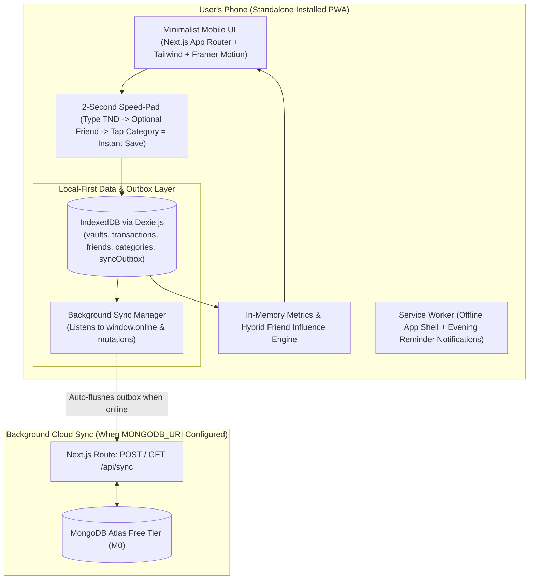

# Kanawita (كنويطة) — Personal Finance & Social Spending Architecture

> **Source of Truth Document**  
> **Version:** 2.0.0 (Post-`/grill-me` Locked Specification)  
> **Currency:** Tunisian Dinar (`TND` / `DT`) with frictionless decimal entry (`4.5` = `4.5 DT`)  
> **Scope:** Single-User Personal Finance, Unified Cash/Vault Balance Tracker, 1-Tap Micro-Spending Logger, Friend Influence Analytics Engine, & Offline-First Phone DB with Background MongoDB Sync  
> **Core Philosophy:** *Maximum financial clarity with near-zero logging friction. Pure objective truth—no preachy AI advice, no bloated itemization, no login walls, and $0/month forever.*

---

## 1. Executive Summary & Locked Vision (`/grill-me` Validated)

Most personal finance apps fail because they demand too much micro-management (choosing which bank account paid for a 200-millime bubblegum, typing item names, and tapping 10 buttons). Within two weeks, the user stops opening the app.

**Kanawita** is engineered around **Frictionless High-Level Truth**:

1. **Unified Total Money Pool + 3 Reference Sources (`Bank (UIB)`, `Savings`, `Post Office (D17)`):**
   - Because you carry physical cash day-to-day and already have the official **UIB** and **D17** apps for exact bank statements, `Bank (UIB)`, `Savings`, and `Post Office (D17)` act as your **3 high-level reference vaults**.
   - Kanawita **sums all 3 sources into 1 Unified Total Balance (`Total Money`)**, and **every spending you log simply subtracts from that single unified total**.
   - You **never** have to select which account a daily spending came from. And whenever you check UIB or D17, you can `+ Add`, `- Subtract`, or `= Set` any of the 3 source balances in one tap.
2. **Tap Category = Instant Save (< 2 Seconds):**
   - On the custom `TND` Speed-Pad, you type the amount (e.g., `4.5`), optionally tap one or more **Friend Chips**, and **the moment you tap a Category icon (e.g., `☕ Coffee`), it saves immediately** (with a 5-second **Undo** toast in case of a mis-tap). Zero extra "Submit" button required.
3. **Single 1-Tap Category Grid (Daily + Monthly Fixed + Self-Care):**
   - All categories live together in one clean grid:
     - **Daily Categories (`kind: 'daily'`):** `Coffee` ☕, `Food` 🍔, `Transport` 🚕, `Entertainment` 🎮, `Clothes` 👕, `Self-Care` 💈 (shampoo, products, barber shop), `Other` 📦.
     - **Monthly Fixed Categories (`kind: 'monthly'`):** `Rent` 🏠, `Bills & Internet` ⚡, `Gym` 🏋️.
   - In the **Metrics** tab, a 1-tap toggle (**"Include / Exclude Monthly Bills"**) lets you filter out `Rent`, `Bills & Internet`, and `Gym` so big monthly bills never distort your daily spending average.
4. **Friend List & Hybrid Influence Engine:**
   - Add and remove friends freely at any time.
   - Auto-classifies each friend as a **Good Influence (🟢)**, **Neutral (🟡)**, or **Bad Influence (🔴)** by comparing their **Average Cost Per Hangout (`CPH`)** against your normal baseline—while letting you **manually flip/override** any friend's badge with 1 tap.
5. **100% Phone Offline Storage (`Dexie.js`) + Background MongoDB Atlas Sync:**
   - Saves all data locally on your phone in IndexedDB (`0ms` latency, works 100% offline with zero API keys).
   - Every mutation is also queued in a local `syncOutbox`. Once you add your `MONGODB_URI` (either in `.env` or inside the in-app **Settings** screen), the app automatically syncs in the background whenever your phone comes online.
6. **Living Project Skill (`/learn` Continuous Alignment):**
   - The repository maintains `.agents/rules/kanawita-vision.md` and `.agents/skills/kanawita-project/SKILL.md`, which must be updated after every phase so the AI agent remains permanently aligned with the codebase and vision.

---

## 2. Requirements & Constraints Matrix

| ID | Domain | Requirement |
| :--- | :--- | :--- |
| **FR-1** | **Unified Balance & 3 Sources** | Display **Bank (UIB)**, **Savings**, and **Post Office (D17)** reference balances, sum them into **1 Unified Total Money** number, and automatically subtract logged spendings from that unified total. |
| **FR-2** | **Source Updates** | Allow quick `+ Add`, `- Take`, or `= Set Balance` on any of the 3 sources (plus optional 1-tap reset of the deducted spending counter when syncing real balances). |
| **FR-3** | **Instant-Save Speed-Pad** | Custom mobile `TND` keypad where tapping a Category icon **immediately saves** the transaction (with a 5-second Undo toast) without requiring a separate Submit button. |
| **FR-4** | **Categories (Daily & Monthly)** | Single 1-tap grid with Daily (`Coffee`, `Food`, `Transport`, `Entertainment`, `Clothes`, `Self-Care`, `Other`) and Monthly Fixed (`Rent`, `Bills & Internet`, `Gym`) categories. |
| **FR-5** | **Friend List & Tagging** | Add/remove friends anytime; assign 1 or more friends to any spending from a horizontal chip bar on the logger. |
| **FR-6** | **Hybrid Influence Classification** | Auto-classify friends into **Good (🟢)**, **Neutral (🟡)**, or **Bad Influence (🔴)** via Average Cost-Per-Hangout vs. baseline, plus 1-tap manual override per friend. |
| **FR-7** | **Metrics & Bill Filter** | Visual metrics with a 1-tap toggle to **Include / Exclude Monthly Bills (`Rent`, `Bills & Internet`, `Gym`)** so daily averages stay accurate. |
| **FR-8** | **Offline + Mongo Sync** | Local-first IndexedDB (`Dexie.js`) storage on the phone + offline `syncOutbox` queue that automatically syncs in the background to **MongoDB Atlas** (`/api/sync`) whenever online. |
| **FR-9** | **Living Skill (`/learn`)** | Build and continuously update `.agents/skills/kanawita-project/SKILL.md` and `.agents/rules/kanawita-vision.md` as the project evolves. |

---

## 3. Winning System Architecture



### Tech Stack
- **Framework:** Next.js (App Router) + TypeScript + Tailwind CSS
- **Animations & Tactile Polish:** Framer Motion (Emil Kowalski-style spring physics, tabular number transitions, smooth drawers) + Lucide Icons
- **Local Phone Database:** `dexie` + `dexie-react-hooks` (`useLiveQuery` for instant 0ms reactive UI)
- **Cloud Database Sync:** `mongodb` native Node.js driver in `src/app/api/sync/route.ts` with Offline Outbox Queue + Last-Write-Wins (`updatedAt`) reconciliation

---

## 4. Core Data Model (`src/domain/models.ts`)

```typescript
export type VaultId = 'uib_bank' | 'savings' | 'post_office';

export interface VaultAccount {
  id: VaultId;
  name: string;        // "Bank (UIB)" | "Savings" | "Post Office (D17)"
  subtitle: string;    // "UIB" | "Épargne" | "D17 / La Poste"
  balance: number;     // Reference amount in TND
  color: string;
  updatedAt: number;
}

export type CategoryKind = 'daily' | 'monthly';

export interface SpendingCategory {
  id: string;
  name: string;
  icon: string;
  color: string;
  kind: CategoryKind;  // 'daily' | 'monthly' (Rent, Bills & Internet, Gym)
  sortOrder: number;
}

export type InfluenceLevel = 'good' | 'neutral' | 'bad';

export interface Friend {
  id: string;
  name: string;
  avatarColor: string;
  manualOverride?: InfluenceLevel | null; // null = auto-calculated from Cost-Per-Hangout
  createdAt: number;
  updatedAt: number;
}

export interface Transaction {
  id: string;
  type: 'spending' | 'vault_adjust';
  amount: number;           // Positive number in TND (e.g., 4.5 = 4.5 DT)
  categoryId?: string;      // Category ID for spendings
  vaultId?: VaultId;        // Optional if adjusting a specific vault
  friendIds: string[];      // Tagged friend IDs (empty array = Solo spending)
  vibe?: 'worth_it' | 'regret' | null;
  note?: string;
  countInBalanceOffset: boolean; // True for spendings created since last vault reset
  timestamp: number;
  updatedAt: number;
  deletedAt?: number | null;
}

export interface SyncOutboxItem {
  id: string;
  collection: 'vaults' | 'categories' | 'friends' | 'transactions' | 'settings';
  documentId: string;
  action: 'upsert' | 'delete';
  payload: unknown;
  timestamp: number;
}
```

### Unified Balance Formula
$$\text{Gross Vaults Total} = \text{Bank (UIB)} + \text{Savings} + \text{Post Office (D17)}$$
$$\text{Remaining Total Money} = \text{Gross Vaults Total} - \sum_{t \in \text{ActiveSpendings}} t.\text{amount}$$
- Whenever you log a `5 DT` coffee, `Remaining Total Money` immediately drops by `5 DT` without asking which account you used.
- Whenever you update a vault balance after checking your UIB or D17 app, you can either update just that vault's number or tap **"Sync & Clear Offset"** so your new real-world balances become the fresh baseline while preserving 100% of your historical spending metrics!

---

## 5. The Hybrid Friend Influence Engine

For each friend $f$ with tagged spendings $T_f$:
1. **Total Social Burn ($B_f$):** $\sum_{t \in T_f} t.\text{amount}$
2. **Hangout Count ($H_f$):** $|T_f|$
3. **Average Cost Per Hangout ($\text{CPH}_f$):** $\frac{B_f}{H_f}$
4. **Baseline Comparison Ratio ($R_f$):** $\frac{\text{CPH}_f}{\text{CPH}_{\text{median}}}$ (compared against median hangout cost across all friends, excluding Monthly Fixed bills like Rent).
5. **Auto Classification:**
   - **Good Influence (🟢):** $R_f \le 0.90$ (hangouts cost less than baseline)
   - **Neutral (🟡):** $0.90 < R_f \le 1.20$
   - **Bad Influence (🔴):** $R_f > 1.20$ (hangouts spike your spending by >20% above baseline)
6. **Manual Override:** If `friend.manualOverride` is set (`'good' | 'neutral' | 'bad'`), it overrides the automatic badge; tapping the badge cycles `Auto` $\rightarrow$ `Good` $\rightarrow$ `Bad` $\rightarrow$ `Neutral`.

---

## 6. Directory Structure

```text
kanawita/
├── ARCHITECTURE.md                              # Source of Truth
├── .agents/
│   ├── rules/kanawita-vision.md                 # Always-on UX & domain guardrails (alwaysApply: true)
│   └── skills/kanawita-project/SKILL.md         # Living codebase & architecture skill
├── public/
│   ├── sw.js                                    # Offline Service Worker & notifications
│   └── icons/                                   # PWA icons (icon-192.svg, icon-512.svg)
├── src/
│   ├── app/
│   │   ├── layout.tsx                           # Mobile-first PWA shell (Space Grotesk + JetBrains Mono)
│   │   ├── manifest.ts                          # Next.js PWA manifest
│   │   ├── page.tsx                             # Main Single-Page App shell with 4 smooth tabs
│   │   ├── error.tsx / global-error.tsx         # Resilient error boundaries
│   │   ├── loading.tsx / not-found.tsx          # Skeleton & 404 routes
│   │   └── api/sync/route.ts                    # Background MongoDB Atlas sync API (GET / POST)
│   ├── domain/
│   │   ├── models.ts                            # Core TypeScript interfaces & Tunisian default seeds
│   │   ├── formatTND.ts                         # TND / DT smart formatter & Speed-Pad keypad engine
│   │   ├── balanceEngine.ts                     # Unified Total Money & 3 Reference Vaults math
│   │   ├── influenceEngine.ts                   # Friend Influence CPH, Manual Override & Combo Duos
│   │   ├── metricsEngine.ts                     # Daily/Monthly burn, Friend Tax, Streak & 28d Heatmap
│   │   └── domain.test.ts                       # Vitest unit suite for all domain engines
│   ├── data/
│   │   ├── db.ts                                # Dexie.js IndexedDB + idempotent starter seed
│   │   ├── repository.ts                        # Atomic mutations + syncOutbox writer + JSON backup
│   │   ├── syncEngine.ts                        # Offline-to-Online background MongoDB sync manager
│   │   └── repository.test.ts                   # Vitest + fake-indexeddb integration test suite
│   └── components/
│       ├── vault/UnifiedVaultHeader.tsx         # Total Money hero + 3 editable source cards + Clear Offset
│       ├── logger/SpeedPadLogger.tsx            # Tactile Keypad + Friend chips + 1-Tap Category auto-save
│       ├── feed/RecentActivitySheet.tsx         # Filterable transactions with 1-tap delete/restore
│       ├── friends/FriendsInfluenceView.tsx     # Add/remove friends + Good/Bad Influence cards + Combo Duos
│       ├── metrics/MetricsDashboardView.tsx     # Charts + "Exclude Monthly Fixed Bills" toggle + Heatmap
│       └── settings/SettingsSyncView.tsx        # MongoDB URI config, sync status, JSON backup, reminders
```

---

## 7. Architectural Learnings & `/learn` Synchronization

1. **Zero-Friction Offset Absorption (`countInBalanceOffset`):**
   - Separating `countInBalanceOffset: boolean` from soft-deletion (`deletedAt`) allows the user to sync their real-world `Bank (UIB)`, `Savings`, or `Post Office (D17)` balance at any time and clear the deducted spending offset in 1 tap (`clearAllSpendingOffsets()` or `updateVaultBalance({ clearSpendingOffset: true })`) without losing a single historical transaction in the Metrics or Friend Influence tabs.
2. **Idempotent Outbox Deduplication (`collection:documentId`) & In-Flight Concurrency Guard:**
   - Keying `syncOutbox` entries as `${collection}:${documentId}` automatically coalesces rapid offline edits to the same document (e.g., cycling a friend's badge 3 times while offline) into a single MongoDB `bulkWrite` operation when connectivity returns.
   - When `syncNow()` completes an in-flight `/api/sync` call, it only deletes outbox entries whose current `timestamp <= sentItem.timestamp`, and `mergeRemoteDataIntoLocal()` skips overwriting any document that still has a pending entry in `syncOutbox` so concurrent local mutations are never clobbered.
3. **Pure Domain Isolation & DST-Safe Calendar Stepping:**
   - Keeping `src/domain/*` 100% free of browser/React/IndexedDB imports enables deterministic `< 5ms` execution in both `useMemo` hooks and automated Vitest suites, while stepping calendar days via `new Date(year, month, day - offset, 12, 0, 0, 0)` prevents DST boundary skips in the 28-day heatmap.


